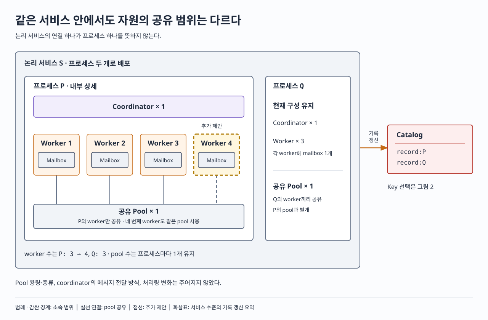
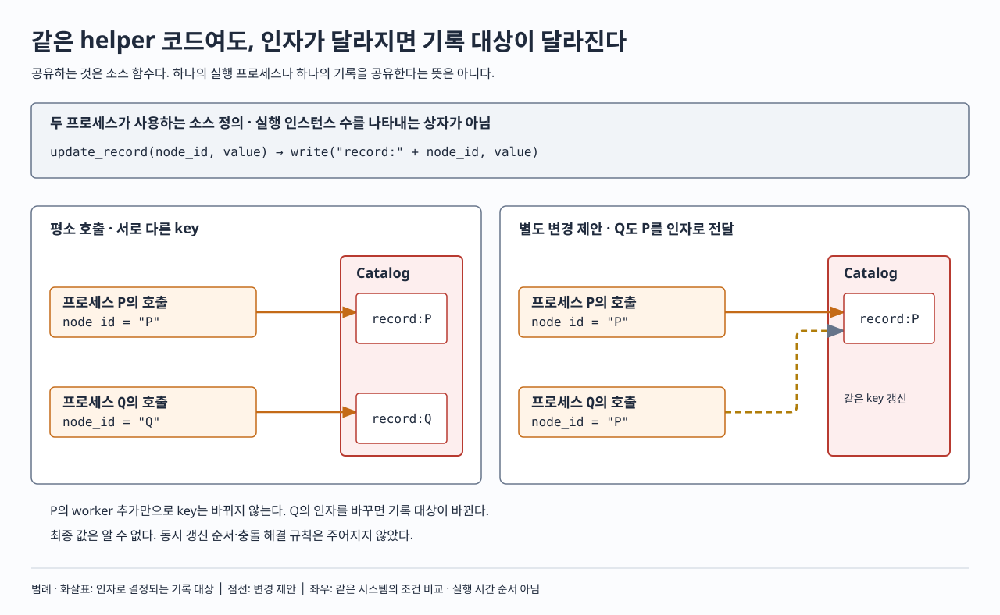

# 공유 범위를 나누어 읽는 서비스 설계

S는 하나의 논리 서비스지만 P와 Q 두 프로세스로 배포된다\. Pool은 각 프로세스의 worker끼리만 공유하고, 같은 helper를 사용해도 기록 대상은 전달한 node\_id로 결정된다\.

## 범위와 공유 자원

그림 1은 P 내부를 펼치고 Q의 같은 기본 구성을 요약한다\. Mailbox는 worker마다 하나이며, pool은 worker 바깥이자 해당 프로세스 안에 하나만 있다\. Catalog는 논리 서비스와 구분한 것이며 별도 서버나 프로세스로 배포된다는 뜻은 아니다\.

근거 주장: [C1](#claim-c1), [C2](#claim-c2)

그림 1\. 점선은 P의 worker 추가 제안이다\. Coordinator의 전달 경로나 호출 순서는 원문에 없어 그리지 않았다\. [제작 명세](briefs/23f126012b9a69af.md)

## 같은 소스 함수와 같은 기록은 다르다

update\_record\(node\_id, value\)를 함께 쓴다는 것은 소스 구현을 재사용한다는 뜻이다\. 평소 P는 P를 넘겨 record:P를, Q는 Q를 넘겨 record:Q를 갱신한다\. Q가 P를 넘기도록 바꾸면 별개 프로세스여도 같은 record:P를 갱신한다\.

근거 주장: [C3](#claim-c3), [C4](#claim-c4)

그림 2\. 좌우는 같은 시스템의 조건 비교다\. 오른쪽 record:Q 생략은 삭제가 아니다\. write 표기는 원본 계약을 풀어 쓴 의사코드다\. [제작 명세](briefs/23f126012b9a69af.md)

## 변경을 적용했을 때 판단할 수 있는 것

| 조건 | 알 수 있는 변화 | 추가 근거가 필요한 것 |
| --- | --- | --- |
| P worker만 3→4 | P mailbox도 하나 추가\. 기존 P pool을 공유\. Q 구성·pool 수·helper 인자와 key 유지\. | 처리량 증가 여부, pool 용량·경합·병목 |
| Q가 P를 전달 | P와 Q 호출이 record:P를 갱신 | 동시 실행 시 최종 값, 갱신 순서, 충돌 해결 |
| 두 변경을 함께 적용 | P worker는 4개이며 P/Q 호출의 기록 대상은 record:P | 전체 성능과 동시 갱신 결과 |

같은 key를 갱신한다는 사실만으로 데이터 손실이나 특정 호출의 승리를 확정할 수 없다\. 실제 적용 전에는 pool의 용량과 사용 방식, helper 호출 주체, Catalog 갱신 계약을 확인해야 한다\. 이 문서는 가상 시스템 설명이며 실제 구현·성능 측정은 수행하지 않았다\.

근거 주장: [C5](#claim-c5)

## 주장과 근거

### claim-c1

사실: S→Catalog는 갱신을 요약한 논리 연결이며 프로세스 수를 지정하지 않는다\.

원본 명시 사항 및 규칙 미명시

출처: S1

### claim-c2

사실: P와 Q는 각각 coordinator 1개, worker 3개와 worker별 mailbox, 별도 pool 1개를 갖는다\.

원본 명시 사항 및 규칙 미명시

출처: S1

### claim-c3

사실: helper는 전달된 node\_id만으로 기록 key를 고른다\.

원본 명시 사항 및 규칙 미명시

출처: S1

### claim-c4

제안: P worker를 4개로 늘리는 변경과 Q가 P를 전달하는 변경은 별개 제안이다\.

원본 명시 사항 및 규칙 미명시

출처: S1

### claim-c5

미확인: 동시 갱신 순서와 충돌 해결 규칙이 주어지지 않아 최종 값은 알 수 없다\.

원본 명시 사항 및 규칙 미명시

출처: S1

## 출처

- [S1 · 가상 시스템 원본 · system\.md, 항목 1–5 · 2026\-11\-25 수신](../system.md)
