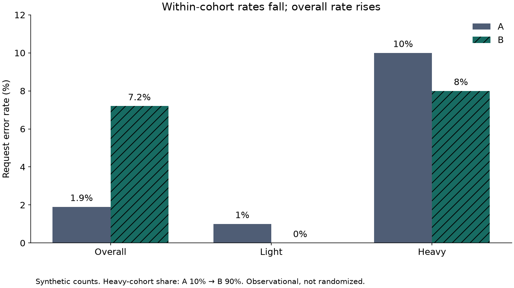

# B의 오류율은 개선됐는가

전체 관측 오류율은 1\.9%에서 7\.2%로 높아졌지만 두 집단 각각에서는 낮아졌습니다\. heavy 요청 비중이 10%에서 90%로 달라진 자료이므로 단일 개선 순위나 인과 효과를 결론내릴 수 없습니다\.

## 원본과 계산 조건

설명용 합성 데이터입니다\. row는 variant·cohort별 같은 설명용 기간의 요청 수와 오류 수이고 관측 단위는 요청입니다\. 사용자 중복·독립성은 제공되지 않았으며 무작위 배정 자료가 아닙니다\.

근거 주장: [C4](#claim-c4)

rate = errors / requests\. 결측·0 denominator·중복 row는 이 입력에 없고 0 errors는 관측값으로 유지합니다\. 전체율은 오류 수 합계 / 요청 수 합계로 계산합니다\.

근거 주장: [C1](#claim-c1)

## 계산 결과

| 범위 | A 오류/요청 | A 오류율 | B 오류/요청 | B 오류율 | B−A | A 대비 상대 |
| --- | --- | --- | --- | --- | --- | --- |
| 전체 | 19/1000 | 1\.9% | 72/1000 | 7\.2% | \+5\.3 pp | \+278\.95% |
| light | 9/900 | 1\.0% | 0/100 | 0\.0% | −1\.0 pp | −100% |
| heavy | 10/100 | 10\.0% | 72/900 | 8\.0% | −2\.0 pp | −20% |

근거 주장: [C1](#claim-c1), [C2](#claim-c2), [C3](#claim-c3)

pp는 percentage point입니다\. 7\.2−1\.9=5\.3 pp와 \(7\.2−1\.9\)/1\.9×100≈278\.95%를 구분합니다\. 전체 오류율은 약 3\.789배이며, 단순히 “5\.3% 증가”라고 쓰면 기준을 혼동합니다\.

근거 주장: [C2](#claim-c2)



그림 2\. 각 집단의 B 관측 오류율은 낮지만 전체는 높습니다\. 원본 count에서 Matplotlib으로 생성했으며 causal effect나 uncertainty interval을 그리지 않았습니다\. [제작 명세](briefs/a4d0990ac661ed22.md)

근거 주장: [C1](#claim-c1), [C3](#claim-c3), [C4](#claim-c4)

## 구성 비중이 결론을 바꾸는 이유

| 요청 비중 | A | B |
| --- | --- | --- |
| light | 90% | 10% |
| heavy | 10% | 90% |

근거 주장: [C3](#claim-c3)

```text
A = 0.9 × 1% + 0.1 × 10% = 1.9%
B = 0.1 × 0% + 0.9 ×  8% = 7.2%
```

B는 오류율이 높은 heavy 요청 비중이 90%입니다\. 따라서 전체 7\.2%를 근거로 각 workload에서 B가 나쁘다고 해석하면 틀리고, 집단별 감소만으로 실제 전체 운영 오류가 줄었다고 해석해도 틀립니다\.

근거 주장: [C1](#claim-c1), [C3](#claim-c3)

## 결론과 한계

확인된 것은 이 표본의 관측 비율과 구성입니다\. B가 오류를 줄인 원인인지, 차이가 우연 변동 범위를 벗어나는지는 확인하지 않았습니다\. B light 0/100은 이 표본의 오류 0건이며 미래 오류율 0 보장이 아닙니다\. 작은 집단 표본과 독립성 미확인을 함께 보고합니다\.

근거 주장: [C4](#claim-c4)

| 시점 | 권장 대처 |
| --- | --- |
| 단기 | 전체·cohort별 비율과 요청 비중 동시 보고, 비교 목표 mix 명시 |
| 중기 | 무작위 배정/비교 조건 통제·사용자/시간/난이도 정보 확보 후 불확실성 분석 |
| 장기 | 목표 workload 표준화와 절대 오류 수·비율을 함께 관측 |

근거 주장: [C5](#claim-c5)

## 재현과 검증

```text
python3 examples/data/analyze.py
python3 examples/data/analyze.py --plot  # Matplotlib 필요
python3 -m unittest discover -s tests -v
```

원본 SHA\-256과 계산 결과는 output/results\.json, SVG/PNG는 output/rates\.\*입니다\. 독립 평가에서는 Decimal로 같은 값을 재계산했습니다\. 수치·단위·zero baseline을 대조하고 실제 PNG를 열어 제목·범례·값·하단 주석의 잘림 여부를 확인했습니다\. 통계적 유의성 검정·uncertainty interval·production 실험은 수행하지 않았습니다\.

## 주장과 근거

### claim-c1

사실: 전체 A 19/1000=1\.9%, B 72/1000=7\.2%다\.

cohort별 비율의 평균이 아닌 전체 오류 수/요청 수\. 같은 총 요청 수에서 오류 53건 증가\.

출처: S1, S3

### claim-c2

사실: 전체 변화는 \+5\.3 percentage points, 상대 약 \+278\.95%, B/A 약 3\.789배다\.

절대 비율 차이와 A 대비 상대 변화는 단위와 기준이 다르다\.

출처: S1, S3

### claim-c3

사실: light는 1%→0%, heavy는 10%→8%이며 heavy 비중은 10%→90%다\.

집단 내 관측 비율은 낮지만 구성 비중이 달라 전체 방향이 뒤집힌다\.

출처: S1, S3

### claim-c4

미확인: B의 인과 효과와 통계적 유의성은 이 계산만으로 확인되지 않았다\.

무작위 배정·요청 독립성·집단 내 난이도 조건이 없다\. 0/100도 미래 오류율 0 보장이 아니다\.

출처: S2

### claim-c5

제안: 전체·집단별 rate와 구성 비중을 함께 보고하고 목표 workload mix를 고정해 비교한다\.

운영의 실제 전체 결과와 같은 구성에서의 비교를 구분하기 위한 제안이다\.

출처: S1, S2

## 출처

- [S1 · 합성 요청·오류 수 · CSV 4행, variant/cohort 합계 · sha256:a11e1ce3c92a31aaa32a4ce93fc2bea1abad830bff74315f321ccbdd80f4fe87](../../input/cohorts.csv)

- [S2 · 표본과 비교 조건 · context\.md 전체 · sha256:e50a86c162dbd3bf42d7a80e5ec42cc0420a28bb4fdd62c26597f1b7dc919bc7](../../input/context.md)

- [S3 · 계산과 plotting 코드 · analyze\(\)/plot\(\), Python \+ Matplotlib · sha256:1cf1ad14cf312137d2a1949fac08ba27bb65b439cc5792fe11ae269c615eeb23](../../analyze.py)
